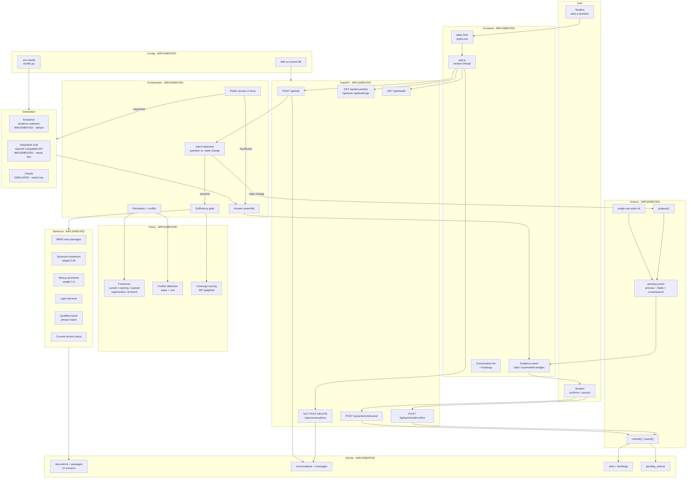
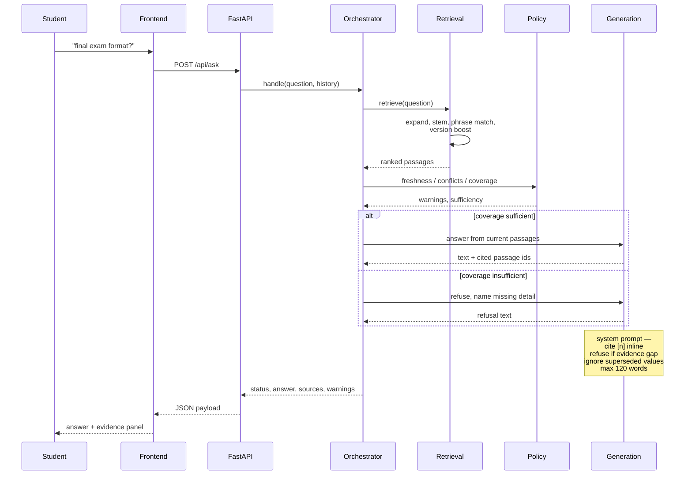
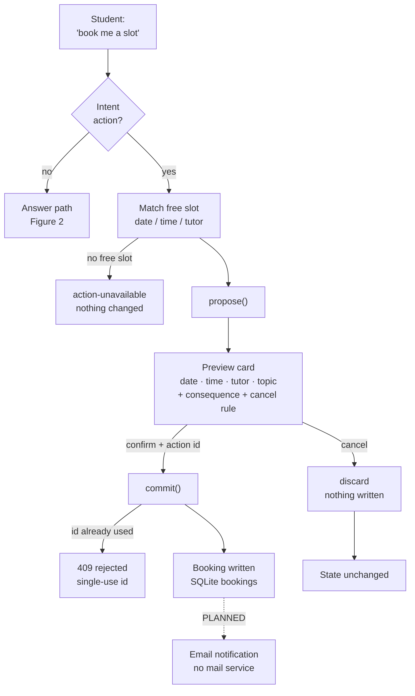
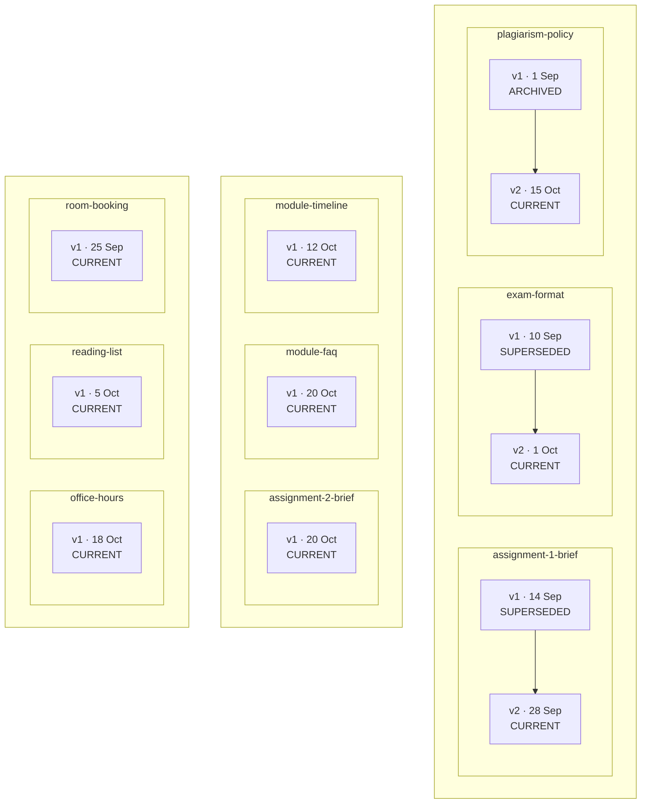

# System diagram — CourseWise

Boxes and arrows only. Short labels. No paragraphs inside the diagram — the
brief counts words inside figures, so every label here is deliberately terse.

Render any block with a Mermaid renderer (GitHub renders Mermaid natively in
`.md` files, mermaid.live, or the VS Code Mermaid extension), or redraw it in
Lucidchart / draw.io using the same labels.

## Legend

| Label | Meaning |
| --- | --- |
| `IMPLEMENTED` | Working code in the submitted commit |
| `SIMULATED` | Interaction is shown, but the backing service is stubbed or local-only |
| `PLANNED` | Designed but not built |

## Figure 1 — System architecture

## Figure 2 — Answer path (control and AI behaviour)

## Figure 3 — State change path (two-phase)

The assistant can only ever reach `propose()`. The `commit()` branch is
reachable only by an explicit `POST /api/actions/{id}/confirm` carrying the
action id, and each action can be committed at most once.

## Figure 4 — Document version tree

Nine document keys, twelve versions: three keys carry a superseded or
archived predecessor, so version resolution and conflict detection have
something to resolve.
